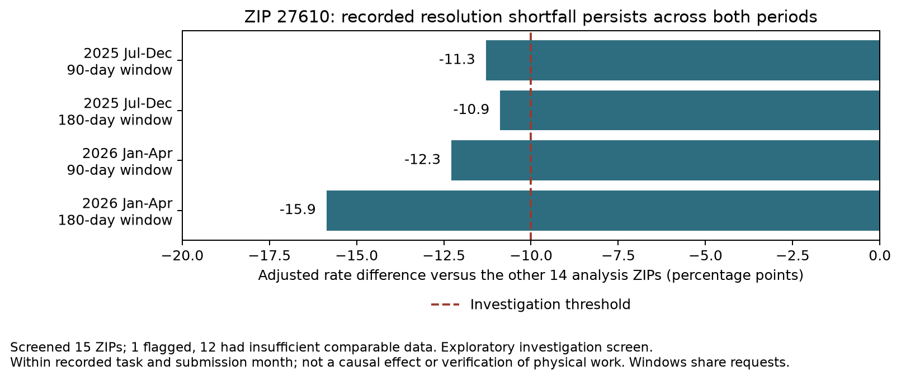
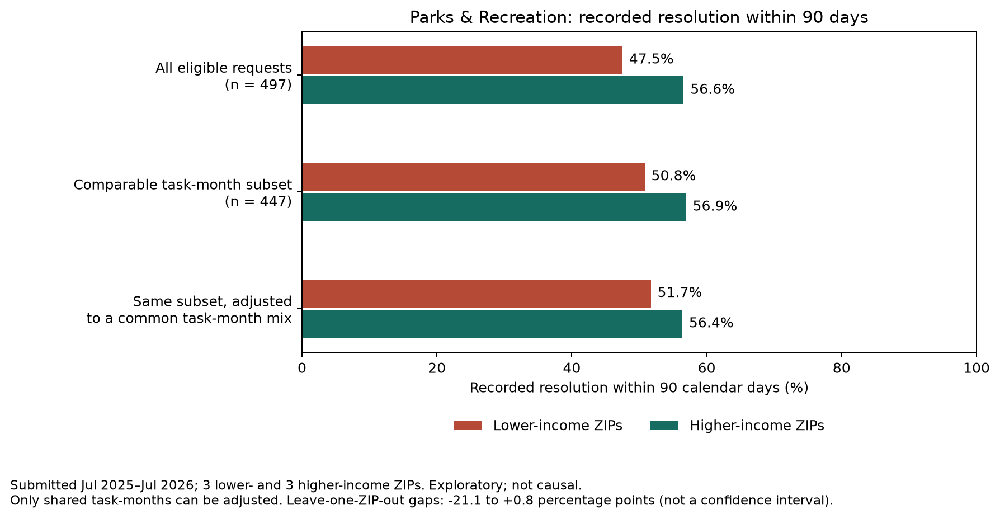
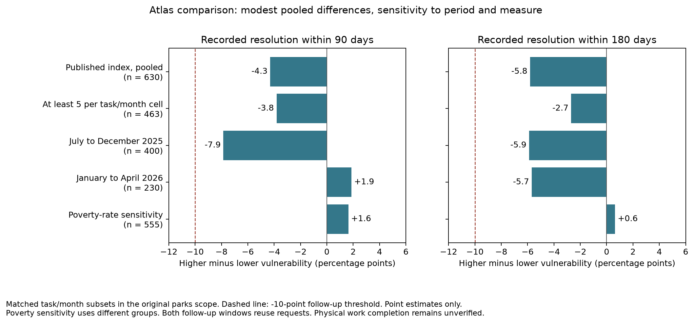

# Raleigh service-request equity analysis

Do reported service needs receive different responses across Raleigh neighborhoods,
and do those differences track neighborhood income or social vulnerability?

This project examines Ask Raleigh service requests alongside Census income data
and Wake County's Community Vulnerability Index.
The findings below use the snapshot downloaded on **November 10, 2026**, with
submissions through November 9. The analysis is exploratory.

## What we found

**Parks requests in ZIP 27610 warrant a targeted records and process review.**
Its recorded resolution rate falls below the comparison ZIPs after accounting for
recorded task and submission month. The shortfall persists across two submission
periods and both 90-day and 180-day follow-up windows.

Broader comparisons using ZIP-level income and block-group social vulnerability
do not show a consistent pattern of disadvantage across the checks we specified.
The Atlas comparison finds a modest pooled shortfall, but its direction changes
with submission period and socioeconomic measure. The local 27610 concern remains
the main investigation lead. We have not established an income or vulnerability
effect, discriminatory treatment, or whether physical work remained unfinished.

## Data and scope

| Source | What it contributes | Scope |
| --- | --- | --- |
| [Ask Raleigh Requests](https://www.arcgis.com/home/item.html?id=9ce6bd1524bc445d9fe7c852ee73b4fb) | Submission and resolution timestamps, status, service labels, ZIP, and coordinates | 18,526 requests in the saved snapshot |
| [2020 to 2024 American Community Survey, table B19013](https://www2.census.gov/programs-surveys/acs/summary_file/2024/table-based-SF/data/5YRData/acsdt5y2024-b19013.dat) | Median household income and margins of error | The original 15 ZIP-code matches, using Census ZIP Code Tabulation Areas |
| [Wake County Community Vulnerability Index, 2020 to 2024](https://www.arcgis.com/home/item.html?id=eb973c734de14652bcadd9af211c751d) | Published area rankings combining five socioeconomic indicators | 597 county block groups; 761 usable parks-request matches in the original scope |

The refreshed request data contain 6,806 more request IDs than the original class
export; all original IDs remain. The 15 original income estimates match the
official ACS release. Income is expressed in 2024 dollars and describes a
five-year period, not household income on the download date.

Different questions require different populations. The completed-request charts
include 13,117 requests matched to the income table. The parks income comparison
uses 497 submissions in six ZIPs from July 2025 through July 2026. The local parks
screen uses 773 submissions across all 15 analysis ZIPs from July 2025 through
April 2026, allowing everyone at least 180 days of follow-up.

The Atlas analysis starts with that same 773-request parks cohort. It retains 761
usable geographic matches, compares 651 requests in the higher and lower
vulnerability bands, and uses 630 with comparable task/month coverage for its
primary adjusted result. The middle band is excluded from that contrast.

These are overlapping populations, not counts to add together. The 15 analysis
ZIPs do not establish complete coverage of all Raleigh residents or service needs.
Postal ZIP codes and Census ZIP Code Tabulation Areas are also different
geographic constructs; matching their codes is an approximation.

## 1. A persistent local shortfall in 27610

The local screen compared each analysis ZIP with the other 14. It matched requests
by service, request type, and submission month, then gave the matched groups the
same weights on both sides of the comparison. This reduces differences caused
by the mix of recorded tasks or when people submitted requests. Task labels do
not capture every difference in difficulty or urgency.

For ZIP 27610, the adjusted recorded resolution rates were:

| Submission period | Follow-up window | ZIP 27610 | Other 14 analysis ZIPs | Shortfall |
| --- | --- | ---: | ---: | ---: |
| July to December 2025 | 90 days | 46.3% | 57.6% | 11.3 percentage points |
| July to December 2025 | 180 days | 52.8% | 63.7% | 10.9 percentage points |
| January to April 2026 | 90 days | 56.6% | 68.9% | 12.3 percentage points |
| January to April 2026 | 180 days | 56.6% | 72.4% | 15.9 percentage points |

These comparisons retain 50 of 59 eligible 27610 requests in the first period
and 33 of 40 in the second. Rates apply to those comparable task/month subsets;
we do not estimate outcomes for the unmatched requests. The two follow-up windows
reuse the same submissions and are not independent replications.



Across all 99 eligible 27610 requests, **46 still have status "New" and no recorded
resolution** at the snapshot:

| Service | Requests still marked New |
| --- | ---: |
| Tree Service | 26 |
| Park and Greenway Service | 15 |
| Playgrounds | 5 |

Those 99 submissions contain 84 distinct address strings. Separate tickets may
refer to the same underlying problem. The 46 tickets provide a concrete starting
point for case review, but they are not 46 verified instances of unperformed work.

### How we decided whether to flag a location

After the initial exploratory results, we committed a stopping policy before
running this local screen. A ZIP had to meet every condition:

- At least 30 parks submissions in each of the two periods.
- Comparable task/month coverage for at least 80% of its submissions in each
  period. Each comparison group needed at least one focal request and five
  requests from the reference ZIPs.
- An adjusted resolution shortfall of at least 10 percentage points in both
  periods, at both 90 and 180 days.

These are practical thresholds for choosing cases to investigate. They are not
a statistical significance test, and the analysis was not preregistered.

| Screen result | ZIPs | Interpretation |
| --- | --- | --- |
| Meets the investigation rule | 27610 | Persistent recorded resolution shortfall under this screen |
| Enough comparable data, but does not meet the rule | 27604, 27607 | No flag under the specified rule; this does not establish equitable service |
| Insufficient comparable data | The other 12 analysis ZIPs | Inconclusive |

The [complete screen results](output/stopping_check/zip_period_windows.csv)
include every ZIP, period, and follow-up window. We are stopping the search for
an income-based headline from this snapshot.

## 2. The income comparison is sensitive to geography

The parks income comparison used the three lowest-income ZIP estimates
(27604, 27605, 27610) and the three highest (27608, 27613, 27614).

Among all 497 eligible submissions, 47.5% of requests in the lower-income group
had a recorded resolution within 90 days, compared with 56.6% in the higher-income
group. The raw difference was 9.1 percentage points.

Matching tasks and submission months retained 447 requests. In that subset, the
unadjusted difference was 6.1 points; giving both groups the same task/month mix
reduced it to 4.7 points. Some of the change from 9.1 to 4.7 points therefore comes
from excluding unmatched cases, not from adjustment alone.



Removing one ZIP at a time changes the adjusted gap substantially. Omitting
27613 slightly reverses its direction. With only three ZIPs per income group,
this result is too sensitive to geography to support an established income
disparity. Thousands of request records do not create thousands of independent
neighborhood income observations.

The broader completed-request scatterplot also shows little linear relationship
between ZIP income and average recorded resolution time (Pearson r is about
-0.06). This does not demonstrate equal service: it combines different tasks
and excludes unfinished requests.

## 3. Finer geography does not produce a consistent vulnerability pattern

The completed Atlas extension tests whether ZIP-level income was hiding a clearer
neighborhood pattern. We first checked the geographic join without examining
resolution outcomes, then committed a separate outcome specification before
calculating differences by vulnerability. This remains an exploratory follow-up;
parks and the request snapshot were already selected in the earlier analysis.

The join provides usable neighborhood context for **761 of 773 parks requests
(98.4%)**. Eleven requests lack coordinates, and one lies in a zero-population
area. Those matches span 201 Census block groups, with a median of only three
requests per group. We pooled areas by the county's published vulnerability
bands instead of estimating performance separately for each small area.

The primary comparison uses the higher two vulnerability bands against the lower
two. After matching tasks and submission months and applying the same weights
to both groups, the 90-day recorded resolution rates are **55.1% in
higher-vulnerability areas and 59.4% in lower-vulnerability areas**, a shortfall
of 4.3 percentage points.

| Comparison | 90-day gap | 180-day gap |
| --- | ---: | ---: |
| Published index, pooled | -4.3 pp | -5.8 pp |
| At least five requests per group in each task/month | -3.8 pp | -2.7 pp |
| July to December 2025 | -7.9 pp | -5.9 pp |
| January to April 2026 | +1.9 pp | -5.7 pp |
| Poverty-rate sensitivity | +1.6 pp | +0.6 pp |

Gaps are higher minus lower vulnerability or poverty. Negative values mean lower
recorded resolution in the higher group. The poverty check defines different
groups, testing dependence on the socioeconomic measure. Matching and the
five-per-cell requirement also change the retained population; exact counts
appear in the chart and detailed results.



Removing one block group at a time leaves the primary gap negative, from -6.5
to -3.2 points. No single area reverses the pooled result, but that stability
does not resolve the reversals across period and measure. The omission range is
not a confidence interval, and these comparisons do not establish statistical
significance or a causal vulnerability effect.

The primary gap falls below the specified 10-point threshold for considering an
additional follow-up lead. The later-period 90-day comparison and the poverty
sensitivity also fail to retain its direction. We stopped at the specified
comparison. **The Atlas adds geographic detail and limits how broadly we can
interpret the local finding; it does not add another actionable location or
establish a consistent disadvantage by income or vulnerability.**

The index has its own limitations. Equal raw indicator values sometimes receive
different component ranks, its tie-handling rules are undocumented, and the
source contains no margins of error. The county Atlas also does not establish
Raleigh service jurisdiction. Neither its rankings nor a park's location
identify the individual residents affected by a request.

See the [feasibility findings](docs/atlas-pilot.md),
[outcome specification](docs/atlas-outcome-plan.md), and
[complete outcome results](docs/atlas-outcome-results.md) for the source audit,
sample sizes, and every planned check. The original 27610 investigation flag
remains unchanged.

## 4. Recorded resolution needs a clearer operational definition

The [official dataset metadata](https://www.arcgis.com/sharing/rest/content/items/9ce6bd1524bc445d9fe7c852ee73b4fb/info/metadata/metadata.xml?format=default&output=html)
describe request status and resolution dates. The saved field descriptions do
not establish that resolution means physical work was completed.

The records also show that resolution and administrative closure are different
events. In 52 records, closure precedes the recorded resolution; two have closure
before submission. Nine records outside terminal statuses retain resolution
timestamps. A single snapshot cannot explain these exceptions or reconstruct
reopenings.

The fixed-window comparisons use the recorded resolution timestamp. They retain
requests with no resolution in the denominator. The 90-day and 180-day windows
are analytical choices, not documented city service commitments.

Before making claims about repairs or unmet physical service, we need the city
to clarify what happens when a ticket is resolved, transferred, referred outside
city responsibility, or reopened. We have not sent a city inquiry or inspected
linked work orders.

## What Raleigh could do with the finding

A proportionate first action is to review the 46 older 27610 tickets still marked
New and check their linked work records. The review should also sample resolved
tickets, so it can test whether the public status reflects the actual service
outcome in both directions.

That review could distinguish a service backlog from routing problems, unclear
responsibility, repeated reports, or incomplete status updates. Only then could
the city choose an appropriate response, such as reassignment, escalation, better
resident updates, or a change in service capacity.

The current analysis supports that investigation. It does not identify a proven
cause or justify a particular budget transfer.

## Corrections made during the audit

Several earlier choices could change the interpretation of the results:

- Requests without coordinates were excluded from nonspatial statistics. The
  shared loader now retains them, restoring 246 completed requests to the main
  income-matched analysis. Maps and Atlas linkage require coordinates;
  nonspatial ZIP comparisons do not.
- Unfinished requests disappeared from completed-request averages. Those charts
  now state their scope, and the fixed-window comparisons include unfinished
  requests in their denominators.
- A metric called "neglect rate" counted completed requests taking over 30 days.
  Its labels now describe that measure accurately. It does not measure the
  outstanding backlog or establish neglect.
- Generic request labels were grouped across different services. The exploratory
  task comparisons now preserve category and service. The five task correlation
  tests also report Bonferroni-adjusted p-values for multiple comparisons.
- A histogram moved durations above 60 days into its final bin. It now leaves
  those observations outside the displayed range while retaining them in the
  denominator. A ZIP ranking graphic also now uses separate axes for percentages
  and days.

The hours-to-days conversion was correct. Reported resolution durations agree
with the timestamp differences to within one hour; almost all are rounded down
to whole hours. The more consequential issues were selection and interpretation.

## Limits on the conclusions

Income is measured for areas, not individual requesters. ZIPs contain different
neighborhoods, and a park's location does not establish who uses it. Income
estimates also have uncertainty: the estimates for 27605 and 27601 differ by only
$254, far less than their margins of error, making membership near the lower-income
cutoff uncertain.

Task/month adjustment cannot account for unrecorded severity, actual staff
responsibility, or differences in residents' use of the reporting system. Service
requests measure reported demand, not all unmet need. Repeated reports and
geographic dependence also limit conclusions drawn from treating tickets as
independent observations.

The local screen flags a persistent pattern under a stated rule. It does not
provide a confidence interval, a calibrated false-positive rate, or a causal
estimate. Most locations remain inconclusive because the comparable samples
are small. The source data and boundary files also need further geographic
validation before making claims about complete city coverage.

## Reproduce the analysis

With Python 3.10 or later and an activated virtual environment:

```bash
python -m pip install -r requirements.txt
python main.py
python deep_dive.py
python zip_choropleth/build_viz.py
python cohort_analysis.py
python stopping_check.py
python -m unittest -v
```

The original analysis has 15 automated tests. Independent calculations reproduced
the adjusted income comparison and all four flagged local comparisons. The
original income-comparison CSV and JSON outputs were unchanged when the local
screen was added.

The exploratory Atlas work adds five spatial tests and two outcome-comparison
tests. All 22 tests passed with `requirements-atlas.txt` installed. Independent
calculations also reproduced all ten Atlas comparisons and all 170 block-group
omission checks. Run
`python atlas_pilot.py` for the geographic checks and `python atlas_outcomes.py`
for the specified outcome comparison. See the
[pilot reproduction instructions](docs/atlas-pilot.md#reproduce) for downloading
or verifying a new county snapshot.

To fetch new source snapshots, run `python refresh_data.py`. Refreshing changes
the active inputs; rerun the analyses and review the conclusions before reusing
the findings above. Detailed provenance, definitions, and formulas are in the
[data documentation](data/README.md).

### Where to find the results

| Location | Contents |
| --- | --- |
| [output/](output/) | Main charts and the sampled request map |
| [output/cohorts/](output/cohorts/) | Parks income comparison, request cohort, and sensitivity results |
| [output/stopping_check/](output/stopping_check/) | All-ZIP investigation screen, decisions, and provenance |
| [output/atlas_pilot/](output/atlas_pilot/) | Atlas geographic coverage, source-index checks, and sample sizes |
| [output/atlas_outcomes/](output/atlas_outcomes/) | Specified vulnerability comparison and all sensitivity results |
| [docs/atlas-outcome-results.md](docs/atlas-outcome-results.md) | Interpretation of the Atlas findings and stopping decision |
| [data/README.md](data/README.md) | Source data, exact eligibility rules, formulas, and stopping policy |

The graphics in `presentation/output/` and `final_presentation/output/` are
historical class-presentation outputs. They have not been regenerated or validated
against the corrected analysis and should not be used as evidence for these
findings.
