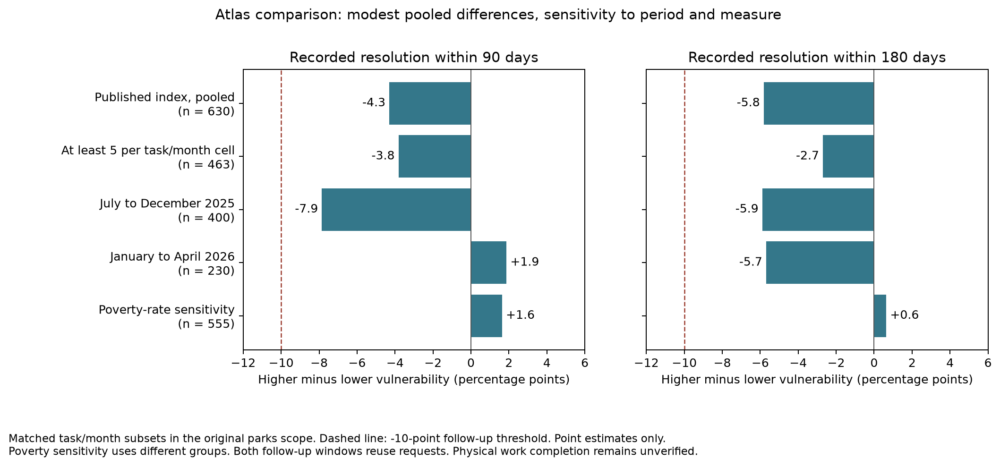

# Atlas outcome comparison: exploratory results

The Atlas adds more detailed geography, but this comparison does not meet the
specified rule for an additional disparity lead. The primary adjusted 90-day
resolution rate is 4.3 percentage points lower in higher-vulnerability areas.
Its direction changes in the later submission period and when poverty rate
alone defines the groups.

The separate 27610 investigation flag remains unchanged. This result does not
establish equal service or rule out smaller or more specific disparities.

## What was fixed before examining outcomes

The [analysis specification](atlas-outcome-plan.md) was committed as `2266436`
after the [feasibility pilot](atlas-pilot.md), before calculating resolution
differences by Atlas classification. It selected one primary comparison and
fixed the sensitivity checks. This remains an exploratory follow-up: parks and
the request snapshot had already been selected during the earlier ZIP analysis.

The population is parks requests submitted from July 2025 through April 2026 in
the original 15-ZIP scope. Of 773 submissions, 761 have a unique geographic match
and a usable county index rank. The primary comparison uses the county's higher
two vulnerability bands against its lower two bands; it excludes the middle band.
That leaves 651 requests across 170 represented block groups. Matching recorded
task and submission month retains 630 requests: 356 in higher-vulnerability areas
and 274 in lower-vulnerability areas.

The endpoint is recorded resolution within 90 elapsed days. Unfinished requests
remain in the denominator. The 180-day check uses the same submissions. Neither
endpoint verifies physical completion or represents a documented city deadline.

## Results

The primary adjusted rates are **55.1% in higher-vulnerability areas and 59.4%
in lower-vulnerability areas**, a higher-minus-lower gap of -4.3 percentage
points. At 180 days the adjusted rates are 59.6% and 65.4%, a gap of -5.8 points.
Both groups receive the same pooled weights across shared task/month categories.
These rates apply to comparable subsets, not to all parks requests.

| Comparison | Comparable requests | 90-day gap | 180-day gap |
| --- | ---: | ---: | ---: |
| Published index, pooled | 630 | -4.3 pp | -5.8 pp |
| At least five requests per group in each task/month | 463 | -3.8 pp | -2.7 pp |
| July to December 2025 | 400 | -7.9 pp | -5.9 pp |
| January to April 2026 | 230 | +1.9 pp | -5.7 pp |
| Poverty-rate sensitivity | 555 | +1.6 pp | +0.6 pp |

A negative gap means lower recorded resolution in the higher-vulnerability or
higher-poverty group. A positive gap means higher recorded resolution there.
The poverty sensitivity defines different groups, so it tests dependence on the
chosen socioeconomic measure rather than reproducing the identical comparison.



The primary comparable coverage is 95.4% for higher-vulnerability requests and
98.6% for lower-vulnerability requests. The period-specific comparisons also
pass the specified count and coverage requirements. The five-per-cell check
retains a smaller population, particularly in the later period; its estimate
cannot be generalized to the excluded cases.

Omitting each of the 170 represented block groups in turn gives primary gaps
from -6.5 to -3.2 percentage points. No one block group reverses the primary
direction. This is a sensitivity range, not a confidence interval. Each omission
re-estimates common support and weights. Request-level independence and spatial
independence have not been established, so no significance claim is made.

The poverty groups use the 40th and 60th percentiles of reported poverty rates
across county block groups with positive population: at or below approximately
3.49% and at or above approximately 7.07%. Ties stay together. These are relative
county cutoffs, not thresholds for classifying individual residents as poor.
The source supplies no margins of error for these rates.

## Decision

The primary shortfall does not reach the specified 10-percentage-point threshold
for considering an additional follow-up lead. The later-period 90-day comparison
and the poverty sensitivity also do not retain the same direction. The area-
omission check is stable, but it does not resolve those other limitations.

Stop this Atlas comparison here. Do not try additional indexes, cutoffs, services,
or geographic boundaries from this snapshot to seek a preferred result. The
outcome remains sensitive to period and measure; the estimates are descriptive
and do not establish a causal vulnerability effect or discriminatory treatment.

The more defensible city-facing next step remains review of the identified 27610
tickets and linked work records. A later analysis with a different population
would require a new question and specification, clearer service/jurisdiction
definitions, and explicit treatment of geographic and reporting uncertainty.

## Verification and reproduction

With the optional environment installed:

```bash
python -m pip install -r requirements-atlas.txt
python atlas_outcomes.py
python -m unittest -v
```

The script requires the frozen request snapshot, Atlas polygons, and the exact
geography file produced by the feasibility pilot. It saves all ten specified
comparisons, the 90-day cohort, and every block-group omission result in
[output/atlas_outcomes/](../output/atlas_outcomes/).

An independent calculation from the raw request CSV and saved county attributes
reproduced all ten adjusted comparisons, both poverty cutoffs, and all 170
omission checks. The optional test suite now has 22 tests, including checks for
contrast direction and keeping poverty-cutoff ties together. No city inquiry
or linked-work-order validation was conducted.
