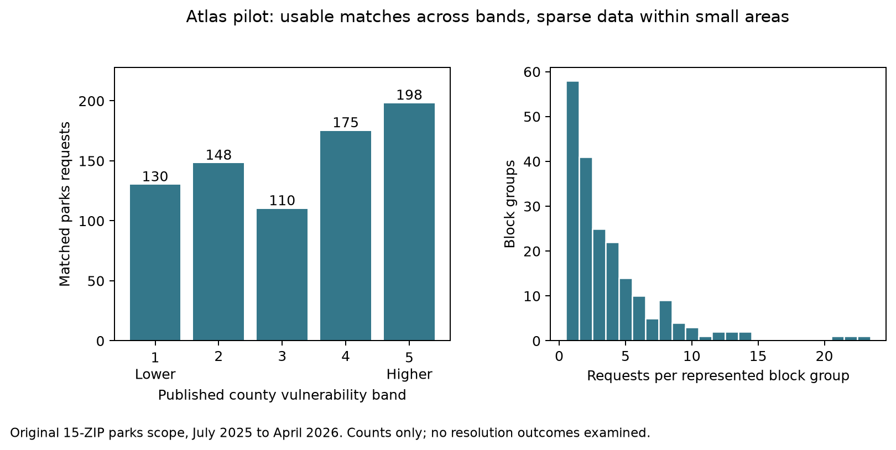

# Wake County Atlas feasibility pilot

Branch: `explore/wake-equity-atlas-pilot`.

## Scope

Use the saved November 10, 2026 Ask Raleigh snapshot. Do not refresh the request
data, change the existing ZIP analysis, or select an Atlas measure by its
relationship to resolution outcomes.

First assess whether request locations can be linked to the county's published
2020 to 2024 Community Vulnerability Index at Census block-group level. This
phase examines source definitions, spatial matches, missing data, and sample
sizes. It does not calculate resolution rates or test disparities.

The main coverage check uses the same 15-ZIP parks cohort as the stopping screen:
submissions from July 1, 2025 through April 30, 2026. Also report geographic
coverage for the full request snapshot and parks submissions outside that scope.
Those diagnostic populations must not silently replace the original cohort.

## Source choice before the join

Use the county's existing Community Vulnerability Index, not a new index built
from selected indicators:

- [Published map, Community Vulnerability Series 2020–2024](https://www.arcgis.com/home/item.html?id=443b36c6f1e4428bad45db641060288e).
- [Underlying service item](https://www.arcgis.com/home/item.html?id=eb973c734de14652bcadd9af211c751d), published in the Wake County ArcGIS organization.
- [Vulnerability assessment polygon layer](https://services1.arcgis.com/a7CWfuGP5ZnLYE7I/arcgis/rest/services/Vulnerability_Assessment_Index_Series_2024/FeatureServer/0).

The service describes five ACS indicators: poverty, unemployment, age dependency,
housing vacancy, and educational attainment. Inspect its component ranks,
`TOTAL_CALC`, and `TOTAL_SCORE` before treating the final value as an index.
The map's existing legend defines the bands; do not choose breaks from the
request outcomes. Higher `TOTAL_SCORE` is displayed as greater vulnerability.

The published layer's low-population areas need explicit checks. A published
rank in an area with no residents is not a meaningful measure of resident
vulnerability. Exclude zero-population areas from usable vulnerability matches,
but retain them in the geographic coverage accounting. Flag areas with fewer
than 100 residents for review without inventing a suppression standard.

## Checks and decision criteria

1. Confirm the publisher organization, map-to-layer lineage, ACS period,
   unique block-group identifiers, and complete feature download. Preserve raw
   inputs, metadata, download times, and hashes.
2. Request polygons in WGS84, matching the request longitude/latitude fields.
   Check geometry validity. Assign a point only when it lies strictly inside
   exactly one polygon. Report boundary points and multiple matches separately;
   do not use nearest-area assignment or infer an area from ZIP alone.
3. Report missing coordinates, locations outside the layer, ambiguous matches,
   missing/invalid scores, and zero-population matches. Keep one output row per
   input request and verify that the join does not duplicate requests.
4. Require at least 95% of all submissions in the original parks cohort to have
   an unambiguous, usable vulnerability match before recommending an outcome
   comparison. This is a practical completeness threshold, not a significance
   test. Report coverage by ZIP and submission month as well as overall.
5. Count requests and distinct block groups across the published bands and
   service/month combinations. Assess whether pooled comparisons have enough
   data; do not assume each block group supports its own statistical test.

County polygons do not establish Raleigh service jurisdiction. In particular,
Raleigh request locations outside Wake County cannot be assigned to the county
Atlas. City limits and service responsibility must be checked before expanding
the analytical population beyond the original scope. Boundary and layer dates
also need to be distinguished from the request dates.

## Next stage

If the pilot supports proceeding, write a separate outcome-analysis specification
before looking at resolution differences. It must fix the geography, primary
measure, grouping, endpoint, follow-up windows, minimum sample sizes, adjustment,
and sensitivity checks. It must also carry forward the unresolved definition of
physical service completion. The original 27610 finding remains a separate lead.

## Pilot results

The pilot passed its geographic completeness criterion. It linked **761 of 773
requests (98.4%)** to a usable county vulnerability rank, without examining
resolution outcomes. Eleven requests lack coordinates. One more lies in a
zero-population block group and has no usable resident-vulnerability measure.
All 762 requests with coordinates matched a single polygon; none required
boundary assignment or a nearest-area estimate.

The source contains 597 unique Wake County block-group polygons. All downloaded
geometries passed validity checks. An independent check against the county
server agreed for six sampled locations: one pilot request from each published
band and one request outside the Atlas. This is a spot check, not exhaustive
verification of geocoding accuracy.

The same procedure linked 15,670 of all 18,526 request records geographically.
There were 2,799 missing coordinate pairs and 57 locations outside the Atlas;
15,669 records had usable vulnerability scores after excluding the one
zero-population match. Coverage for the full dataset is therefore lower than
coverage for the selected parks cohort. Neither population establishes complete
coverage of Raleigh or all city service needs.

### Sample sizes

| Published vulnerability band | Parks requests | Distinct block groups |
| --- | ---: | ---: |
| 1, lower vulnerability | 130 | 38 |
| 2 | 148 | 38 |
| 3 | 110 | 31 |
| 4 | 175 | 43 |
| 5, higher vulnerability | 198 | 51 |



The 761 usable matches span 201 block groups, with a median of three requests per
group and a maximum of 23. No block group has 30 requests. Separate outcome tests
or a performance ranking for each block group would be poorly supported.
Pooling requests across vulnerability bands is more feasible.

A count-only comparison of the lower two bands with the higher two bands gives
186 versus 227 requests in July to December 2025 and 92 versus 146 in January to
April 2026. Requiring at least one request per group in a shared task/month
retains 94.5% to 100% of each group in each period. Requiring five per group
retains only 56.2% to 79.6%. These counts show the tradeoff between sparse cells
and the population retained. They are not comparisons of service outcomes.

### Index definition and limitations

The published map classifies `TOTAL_SCORE`, with breaks at 119, 238, 358, 477, and
597. These are county-relative ordinal ranks, not percentages or units of need.
The source's `TOTAL_CALC` equals the sum of its five component ranks in all 597
rows, and `TOTAL_SCORE` increases with that total. No analyzed index fields are
null. The source attributes and geography identifiers join without duplicate
keys; `GEOID` and `GEOID_DATA` agree throughout.

Equal raw values do not always receive equal component ranks. For example, 190
block groups have reported housing vacancy of zero but receive ranks from 1 to
190. There are also 100 rows beyond the unique set of summed-rank totals, yet
all final ranks are unique. No summed-total tie crosses one of the five map-band
boundaries in this snapshot. The service does not explain how ties are ordered.
This is a limitation of interpretation and reproducibility, not proof that the
county index is erroneous. A later outcome specification needs a sensitivity
check using a simpler documented indicator, such as poverty rate, rather than
treating the composite ranking as a precise scale.

The five indicator rates are on a 0 to 100 scale. One polygon has no residents;
one has five. Neither supplies a useful general picture of a residential
neighborhood. The zero-population match is excluded from usable coverage, and
none of the usable pilot matches lies in a block group with fewer than 100
residents. The layer contains no margins of error, and component denominator
uncertainty has not been reconstructed.

The provider identifies the ACS period as 2020 to 2024. Its data edit timestamp
is February 17, 2026, and its later layer edit timestamp is July 23, 2026.
The polygon-boundary vintage is not explicitly documented in the inspected
metadata. The server supplied polygons in WGS84 for the join; the native layer
uses a projected coordinate system. Source snapshots and query parameters are
preserved so these distinctions can be inspected.

## Decision and remaining work

Proceed to a separately specified **pooled** vulnerability comparison, with
explicit geographic scope and an index sensitivity check. Do not run separate
tests for each block group, interpret request counts as unmet need, or treat
this feasibility result as evidence of a service disparity.

Before the outcome stage:

1. Fix whether the population stays within the original 15-ZIP parks scope or
   expands to geocoded requests within Raleigh's city/service jurisdiction.
   The latter requires a verified boundary and an explicit policy for Raleigh
   locations outside Wake County. Current boundaries may differ from those at
   the time of a request.
2. Specify the primary published vulnerability grouping and a poverty-rate
   sensitivity, the fixed-follow-up endpoint, adjustment weights, comparable
   coverage requirements, and treatment of within-area dependence. Freeze these
   choices before examining resolution differences.
3. Carry forward the uncertainty about whether a resolved ticket represents
   completed work. That issue is unchanged by the Atlas join.

The original 27610 results and all saved request inputs are unchanged. This
branch contains no Atlas outcome comparisons, significance tests, or newly
selected disparity headline.

## Reproduce

Install the optional dependency set in an activated environment:

```bash
python -m pip install -r requirements-atlas.txt
python atlas_pilot.py
python -m unittest -v
```

`python atlas_pilot.py --download` saves a new county snapshot before rerunning
the pilot; it does not refresh the request data. `--verify-server` checks the six
sampled point assignments against the live county service and requires that its
edit metadata still match the frozen layer.

Raw inputs and hashes are in [data/atlas_pilot/](../data/atlas_pilot/). Outputs in
[output/atlas_pilot/](../output/atlas_pilot/) include one geography row per request,
coverage by ZIP/month/service, band and area counts, common-support counts,
source-index audits, and the sampled server verification. The five spatial
regression tests cover holes, multipart polygons, ambiguous boundaries,
overlaps, missing and invalid coordinates, duplicate geography keys, and legend
cutoffs. The complete optional-environment suite has 20 tests.
